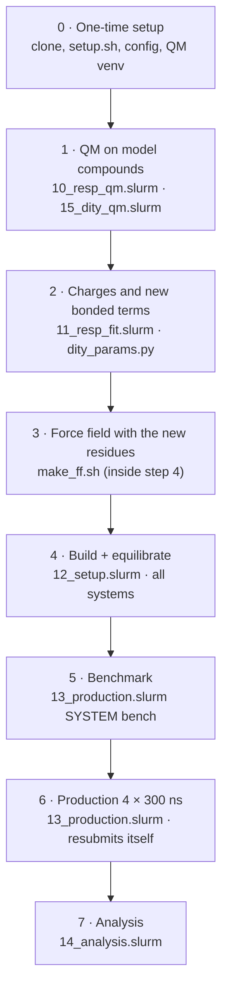

# Phl p 5a: oxidative tyrosine modifications in free MD

Unrestrained molecular dynamics (MD) of the first helical domain of the
major grass pollen allergen Phl p 5a, with its tyrosines modified the way
peroxynitrite modifies them: hydroxylation (L-DOPA, TOPA), nitration
(3-nitrotyrosine) and cross-linking (dityrosine). One experiment, one
pipeline: every modification goes through the same steps (parameters →
system → equilibration → production → analysis), and all systems are
compared with the same wild-type runs and with the modification data of
Bothen et al. (*Free Radic. Res.* 2026).

The experiment runs in two phases. **Phase 1 (now)** is a pilot: ten
systems that use every kind of modification at least once, to check that
the pipeline works end to end and gives sensible, reproducible results.
**Phase 2** goes through the tyrosines and modifications systematically.

Unlike the SSI runs in the main workflow (protein heavy atoms restrained, so
the structure cannot change), everything here is free MD, including the
wild-type reference. The directory is called `dopa/` and the branch
`dopa-y65` because the study started with Y65 → DOPA.

**Contents:** [Background](#background) ·
[Experiment plan](#experiment-plan) ·
[One pipeline for all modifications](#one-pipeline-for-all-modifications) ·
[Design decisions](#design-decisions) ·
[Status](#status-pilot-snapshot-of-28-october-2026) ·
[Hydroxylation: DOPA and TOPA](#hydroxylation-dopa-and-topa) ·
[Cross-link: dityrosine](#cross-link-33-dityrosine-y65y127-x65_127) ·
[Analysis](#analysis) ·
[Running on Viper](#running-on-viper) ·
[Limitations](#limitations) · [Files](#files) · [References](#references)

---

## Background

**Chemistry.** Peroxynitrite (ONOO⁻), formed under oxidative stress and
enhanced by air pollution, decomposes into ·NO₂, CO₃·⁻ and a small amount of
·OH. These radicals modify tyrosines in three ways: nitration
(3-nitrotyrosine), cross-linking (dityrosine) and hydroxylation. Hydroxylation
starts with ·OH adding to the aromatic ring; addition next to the phenolic OH
(at CE1 or CE2) and subsequent oxidation gives L-DOPA, a catechol with two
adjacent OH groups. In LC-MS/MS hydroxylation shows up as +16 Da, which
neither distinguishes DOPA from other hydroxylation products nor tells on
which ring edge the new OH sits.

**Phl p 5a.** In Bothen et al. (*Free Radic. Res.* 2026,
doi:10.1080/10715762.2026.2752377) all 12 tyrosines of Phl p 5a were
modified site-selectively. **Y65** stood out: highest nitration degree at
every peroxynitrite dose (~95 % at 5:1), mostly single nitration, and
3.1 % hydroxylation. It sits in an α-helix (residues 64–84) of the first
helical domain and is partly buried (relative solvent accessibility 0.23).
In the AlphaFold 3 model its ring packs into a cluster with three other
tyrosines (Y112, Y124, Y127; ring atoms 3.5–4.1 Å apart). Y65 forms
cross-links with Y124 and Y127 that persist at the highest dose and match
NMR contacts, i.e. are likely intramolecular. The domain holds five
tyrosines (Y65, Y108, Y112, Y124, Y127).

**Questions.**

1. *Effect of a modification:* does a modified tyrosine change the local
   structure (packing in the tyrosine cluster, hydrogen bonds, side-chain
   conformation, flexibility, helicity)? Modified residues can alter how an
   allergen is recognized by the immune system.
2. *Origin of the site selectivity:* does the dynamics of the unmodified
   protein explain which tyrosines are modified and which pairs cross-link
   (transient exposure of the reactive atoms, Tyr–Tyr approach), better than
   the single structure used in the paper?
3. *Sequence of events:* does a first modification (e.g. at Y65) change the
   exposure of its neighbours and so the next modification?

**What free MD can and cannot answer.** In a few hundred nanoseconds MD
samples local rearrangements: side-chain repacking, hydrogen-bond networks,
fraying of helix ends. It does not sample unfolding or give a
thermodynamic stability change (ΔΔG); that would need alchemical
free-energy calculations (e.g. Gapsys et al. 2016). Because MD is chaotic,
a single run is one sample; differences only count if they exceed the
spread between independent replicas (Knapp et al. 2018; Grossfield et al. 2018).

---

## Experiment plan

### Phase 1: pilot (running)

Ten systems, chosen so that every part of the pipeline is used once:
two new residue types for hydroxylation, a cross-link with a new bond, three
sites, both ring orientations, and the wild type as the common reference.

| System | Modification | Why in the pilot |
|--------|--------------|------------------|
| `wt` | none | reference for every comparison; exposure and Tyr–Tyr contacts vs. Table 1 of the paper |
| `dah_ce1`, `dah_ce2` | Y65 → DOPA | most modified site; first residue type with new parameters |
| `y112_dah_ce1`, `y112_dah_ce2` | Y112 → DOPA | hydroxylated in the paper (1.6 %); most exposed Tyr of the cluster |
| `y127_dah_ce1`, `y127_dah_ce2` | Y127 → DOPA | hydroxylated (0.7 %) although buried at residue level |
| `y65_top_ce1`, `y65_top_ce2` | Y65 → TOPA (2,4,5-trihydroxyphenylalanine) | multi-hydroxylation was detected; second hydroxylated residue type |
| `x65_127` | 3,3'-dityrosine Y65–Y127 | cross-link of the paper; tests new bonded terms and the bond-growth setup |

4 replicas × 300 ns each. Questions the pilot has to settle before phase 2:

- Does every step run without manual fixes for all residue types?
- Does the WT reproduce the static exposures of Table 1 at the start, and
  how much do they fluctuate?
- Are the replica spreads small enough that effects of the size seen here
  can be resolved with 4 × 300 ns, or are longer runs or more replicas needed?
- Are both ring orientations of a hydroxylated Tyr needed, or does one
  orientation convert into the other during the run?

### Phase 2: systematic (planned)

The same pipeline over the tyrosines and modifications of the paper. What it
needs on top of the pilot:

| Modification | Sites / pairs | What is new |
|--------------|---------------|-------------|
| 3-nitrotyrosine | Y65, Y108, Y112, Y124, Y127 | the main modification in the paper (ND up to 95 %); new residue: parameters for the NO₂ group with the same Tyr-referenced RESP protocol, ring–NO₂ torsion from a QM scan as for the dityrosine bridge |
| DOPA | Y108, Y124 (Y65, Y112, Y127 done in the pilot) | nothing new |
| 3,3'-dityrosine | Y65–Y124 (paper), further pairs that come close in the WT runs | start structures for pairs whose ortho carbons are far apart in the model |
| isodityrosine (C–O) | pairs with short ortho C···O distances in the WT (e.g. Y65–Y112) | new bond type, parameters as for dityrosine |
| sequential modifications | e.g. nitrated Y65 + DOPA or a cross-link at a neighbour | combinations of existing residues |
| domain 2 tyrosines | Y207, Y210, Y224, Y236 | a second domain system (residues ~161–257) |

Which systems are worth running follows from the pilot (exposure and
contacts in the WT, size of the effects) and from the modification
degrees in Tables S3/S4 of the paper.

---

## One pipeline for all modifications



| Step | What happens | Why it is needed | Script | In → out | Cost (Viper) |
|------|--------------|------------------|--------|----------|--------------|
| **0** One-time setup | clone branch, `setup.sh` (paths), `config/workflow.env` (GROMACS, modules), Python venv with PySCF | scripts need absolute paths and the self-compiled GROMACS; new residues need a QM program (ORCA is license-restricted at MPCDF) | `setup.sh`, `params/make_qm_venv.sh` | – → configured checkout, venv | minutes, login node |
| **1** QM | per new residue: capped dipeptides Ace-X-NMe optimized at HF/6-31G* with φ/ψ frozen (DOPA 4, TOPA 8 conformers, Tyr 2 as reference), electrostatic potential (ESP) on ~9 000 points around each; for a cross-link also the bridge model compound and a torsion scan | the force field does not know the modified residues; charges must be derived exactly like the existing amber charges, from the ESP of a QM calculation | `slurm/10_resp_qm.slurm` (array), `slurm/15_dity_qm.slurm` | – → `runs/dopa/qm/<conf>/`, `runs/dopa/qm_dity/` | per conformer 16 cores, ~0.5–2 h |
| **2** Parameters | RESP fit over all conformers, Tyr fitted the same way as a check, Tyr-referenced charges; new bonded terms (e.g. the dityrosine bridge) fitted to the QM scan | charges must not depend on one conformation; the Tyr refit shows whether the protocol reproduces ff99SB | `slurm/11_resp_fit.slurm`, `params/dity_params.py` | QM files → `params/results/`, `ff/*.rtp`, `ff/*.hdb`, `ff/dity_*.itp` | 1 core, minutes |
| **3** Force field | copies amber99sb-ildn, appends the new residues (`DAH`, `TOP`, `DTY`) and bonded terms, registers them as protein | GROMACS can only build topologies for residues it knows; "Protein" index groups must include them | `ff/make_ff.sh` (called in step 4) | → `<system>/amber99sb-ildn-dopa.ff/`, `residuetypes.dat` | seconds |
| **4a** Build | cuts domain 34–144 from the AF3 model, adds ACE/NME caps, applies the modification named by the system (new O atoms, ring orientation, cross-link rotamers), adds hydrogens (`pdb2gmx`) | a smaller, well-folded system is ~20× cheaper; caps avoid artificial charged ends; both ring orientations are needed (see below) | `src/make_system_pdb.py`, `12_setup.slurm` | AF3 model → `start.pdb`, `topol.top` | seconds |
| **4b** Cross-links only | the new bond is grown from the start distance to its equilibrium length over 200 ps, with the surroundings free to adapt | the two ring carbons cannot be put at bond distance in the rigid model | `src/crosslink_topology.py`, `mdp/grow.mdp` | → `topol_grow.top` | minutes |
| **4c** Solvate + ions | rhombic dodecahedron (1.2 nm to the wall), TIP3P water, neutralize, 0.15 M NaCl | protein behaviour depends on water and ionic strength; Y65 has charged neighbours | `12_setup.slurm` | → `solv_ions.gro` (~35–40k atoms) | seconds |
| **4d** Energy minimization | steepest descent | removes atom overlaps from building (e.g. a new O pointing at a neighbour) | `12_setup.slurm` | → `em.gro` | minutes |
| **4e** NVT 100 ps, restrained | heat to 300 K with random velocities, one seed per replica, protein heavy atoms restrained | water must relax around the fixed protein first; different seeds make the 4 replicas independent | `12_setup.slurm` | → `rep*/nvt.gro` | minutes |
| **4f** NPT 1 ns, restrained | pressure coupling to 1 bar, still restrained | box volume and water density must settle before the protein is released | `12_setup.slurm` | → `rep*/npt.gro`, `rep*/md.tpr` | ~10–30 min |
| **5** Benchmark | 20 000 steps of production | real ns/day on Viper → how many 12 h jobs production needs | `13_production.slurm SYSTEM bench` | → `rep*/bench.log` | ~10 min |
| **6** Production | 300 ns unrestrained NPT per replica, 4 replicas per system with `mdrun -multidir`; continues from checkpoints and resubmits itself every 12 h | only unrestrained dynamics shows structural change; 4 independent replicas give error bars | `13_production.slurm` | → `rep*/md.xtc` (protein every 10 ps) | `DOPA_PROD_NODES` (4) nodes per system; days |
| **7** Analysis | whole/centered protein trajectories, side-chain SASA, then per site the comparison WT vs. modified systems; exposure of the reactive Tyr atoms and Tyr–Tyr contacts vs. the paper | turns trajectories into numbers with mean ± SEM over replicas | `14_analysis.slurm`, `src/analyze_dopa.py`, `src/tyr_exposure.py` | → `runs/dopa/analysis/` | 1 node-share, ~1 h |

**What differs per modification.** Only steps 1–4a(b); from solvation on,
every system goes through the same scripts and analysis.

| Residue | Modification | Parameters | Building | Status |
|---------|--------------|------------|----------|--------|
| `DAH` | L-DOPA (3-OH) | RESP, 4 conformers, Tyr-referenced; bonded terms from parm99 | new O on CE1 or CE2 (`ce1`/`ce2` variants) | pilot |
| `TOP` | TOPA (2,4,5-OH) | RESP, 8 conformers, Tyr-referenced; bonded terms from parm99 | as DOPA + OH on the CD carbon para to the 3-OH | pilot |
| `DTY` | 3,3'-dityrosine (half) | RESP of the bridge model, bridge torsion fitted to a QM scan, new type `CP` | rotamer search + bond growth | pilot (Y65–Y127) |
| – | 3-nitrotyrosine | to do: RESP + ring–NO₂ torsion | new NO₂ on CE1 or CE2 | phase 2 |
| – | isodityrosine | to do: C–O bridge terms | as dityrosine | phase 2 |

System names (`src/make_system_pdb.py`): `wt`;
`y<N>_<dah|top>_<ce1|ce2>` (`ce1`/`ce2` = ring carbon that gets the new
3-OH, named as in the AF3 model; `dah_ce1`/`dah_ce2` are Y65);
`x<A>_<B>` = 3,3'-dityrosine between Tyr A and Tyr B. The list of systems is
`DOPA_SYSTEMS` in `dopa.env`.

---

## Design decisions

| Choice | Value | Why |
|--------|-------|-----|
| Structure | AF3 model (`examples/PHLP5/PHLP5_input.pdb`), same as in the paper | there is no complete experimental structure of Phl p 5a |
| System | helical domain 1, residues 34–144, ACE/NME caps | N-terminus (1–35), linker (141–160) and C-tail (258–287) have pLDDT < 50 (likely disordered); full length is ~17 nm long, ~800k atoms in a cube vs. ~35–40k for the domain; every residue within 6 Å of the Y65 side chain lies in 61–127, and the domain touches the rest of the model at a single residue (222); NMR data indicate largely independent domains (Göbl et al. 2017) |
| Ring orientation | both (`ce1`, `ce2`) for every hydroxylated Tyr | the new 3-OH sits on either ring edge; packed rings flip on µs–s time scales (Weininger et al. 2014), so the starting orientation may persist through 300 ns |
| Force field | amber99sb-ildn + TIP3P | validated for folded proteins (Lindorff-Larsen et al. 2010, 2012); shipped with GROMACS; ff99SB-ILDN differs from ff99SB only in side-chain torsions of Ile, Leu, Asp, Asn, so charges derived for ff99SB apply unchanged |
| New residues | Tyr-referenced RESP charges, parm99 bonded terms, QM-fitted terms only where parm99 has none | consistent with the amber protein charges; the WT–modified difference comes from the modification, not from the derivation (see [charges](#hydroxylation-dopa-and-topa)) |
| Ions | neutralize + 0.15 M NaCl | physiological ionic strength; Y65 neighbours D63, K64, R66, E116, K123 |
| Box | rhombic dodecahedron, 1.2 nm | ~71 % of the volume of a cube with the same periodic distance |
| Thermostat / barostat | V-rescale 300 K (Bussi et al. 2007), C-rescale 1 bar (Bernetti & Bussi 2020) | correct ensembles, robust |
| Production | 4 replicas × 300 ns per system, one node per replica | 300 ns covers local rearrangements; 4 nodes per system run ~2.6× faster than 1 node (benchmark 2026-10-27) |
| Walltime | 12 h jobs, `-maxh 11.5`, automatic resubmission | cluster limit |

**Ring orientation in the model.** In `dah_ce2` the new O starts 2.5 Å from
the ring of Y127 (in `dah_ce1` the nearest atom is 4.7 Å away): that ortho
carbon is sterically blocked in the model, so hydroxylation there is less
likely. Energy minimization removes the clash. Similarly
`make_system_pdb.py` prints the closest atom to each new oxygen: Y112-OE2
points at E116-OE1 (ce1, 2.2 Å) or Y65-OH (ce2, 3.3 Å), i.e. H-bond partners;
Y127-OE2 starts close to F68 (ce1, 2.5 Å) or the Y112 backbone N (ce2,
2.8 Å). Compare with the atom-level ASA of CE1/CE2 in Table 1 of the paper;
if one side is clearly inaccessible, that variant can be treated as a control.

---

## Status: pilot, snapshot of 28 October 2026

All ten systems are in production (4 nodes each). Before the Viper
maintenance (28.10.–02.11.2026) an interim analysis ran on the trajectories
written so far: 110–138 ns per replica, frames every 50 ps, first 50 ns
discarded, i.e. 60–88 ns per replica and 4 replicas per system. Production
continues after the maintenance; the numbers below will change.

**Pipeline.** Parameters, building, equilibration and production ran for all
four residue types (TYR, DAH, TOP, DTY) without manual fixes. The analysis
ran for all systems; the interim run found three bugs in
`analyze_dopa.py` that are fixed now (DSSP skips non-standard residues, so
helicity is mapped by residue number; the side-chain SASA read the total
protein column of `gmx sasa`; plot colours for more than four systems).

**Wild type vs. the paper** (ASA in Ų, MD mean over replicas; Table 1 in
parentheses; ortho = CE1 + CE2):

| Tyr | phenol O | ortho | meta | Observation |
|-----|----------|-------|------|-------------|
| Y65 | 8.8 (10.3) | 15.9 (16.1) | 7.2 (10.3) | CE1 always accessible, CE2 always buried |
| Y108 | 1.7 ± 1.5 (0.0) | 6.3 (5.2) | 11.1 (19.2) | O accessible in 13 % of the frames; one replica opens after ~110 ns (O up to ~28 Ų) |
| Y112 | 31.2 (20.7) | 37.0 (31.6) | 22.2 (17.4) | switches between two states (O ≈ 38 or ≈ 20 Ų) |
| Y124 | 10.4 (14.3) | 16.2 (16.3) | 4.6 (4.0) | stable |
| Y127 | 7.0 (11.3) | 1.5 (2.6) | 0.1 (0.0) | ortho accessible in 45 % of the frames, meta buried |

Tyr pairs (shortest ortho···ortho C···C; fraction of frames ≤ 4.5 Å):
Y65–Y127 4.7 Å, 36 ± 7 % (cross-link in the paper); Y65–Y124 8.0 Å, never
below 5.1 Å (cross-link in the paper, but no approach so far); Y65–Y112
5.6 Å, 6 %, while ortho C···OH is ≤ 4.5 Å in 79 % (NMR contact; geometry for
isodityrosine); Y112–Y127 27 ± 20 %.

**Modified systems** (site comparison, mean ± SEM, Welch p vs. WT):

- Y127 → DOPA: helicity of helix 123–140 drops from 0.90 ± 0.04 to
  0.67 ± 0.07 (`ce1`, p = 0.04) and 0.74 ± 0.03 (`ce2`, p = 0.02).
- Y65 → TOPA `ce2`: χ1 of residue 65 mostly g+ (68 ± 22 % vs. 0 % in WT),
  ring distance 65–112 8.8 vs. 7.3 Å (p < 0.001); in `ce1` the OH groups
  H-bond to E116 (~30 %).
- Y65 → DOPA `ce2`: ring turned > 90° from its start in 43 ± 26 % of the
  frames (WT: 0.04 %), i.e. the orientation is not fixed.
- Y65 → DOPA `ce1`: Y127 less exposed (O 2.9 vs. 7.0 Ų), Y108 more
  (O 7.3 vs. 1.7 Ų); within the large replica spread of Y108.
- `x65_127`: bridge stable (ring distance 4.38 Å); Y65–Y112 ring distance
  7.8 vs. 7.3 Å (p = 0.03).
- Core Cα RMSD 2.2–3.3 Å and RMSF (maximum in the loop at residues 86–91) do
  not differ significantly between the systems.

**Open.** Modification degrees missing from the main text (ND of Y108, Y124,
Y127; HD of Y108; Tables S3/S4) in `data/bothen2026_tyr.tsv`; full 300 ns
and the final analysis after the maintenance; the decisions for phase 2
listed [above](#phase-1-pilot-running).

---

## Hydroxylation: DOPA and TOPA

**Bonded terms** come from parm99 (Wang et al. 2000). Both hydroxylated ring
carbons are typed `CA` (Tyr uses `C` for CZ, but the angle `C–CA–OH` is not
defined), so `CA–OH`, `CA–CA–OH`, `CA–OH–HO`, `X–CA–OH–X` and the improper
`CA–CA–CA–OH` cover the catechol. Nothing new is invented.

**Partial charges** are derived with the recipe used for the amber protein
charges (Bayly et al. 1993; Cornell et al. 1995; Cieplak et al. 1995). Charges
from other libraries (e.g. Forcefield_PTM, Khoury et al. 2013) follow the
ff03 recipe and would be inconsistent with ff99SB.

- Ace-DAH-NMe, backbone α (φ, ψ = −60°, −40°) and β (−120°, 140°), φ/ψ
  frozen, everything else relaxed; both intramolecular catechol H-bond
  patterns (3-OH or 4-OH donating) → 4 conformers
- HF/6-31G* gas phase (deliberately overpolarized, mimicking water, as in
  ff94), Cartesian d functions as in Gaussian's 6-31G*; PySCF (Sun et al. 2020)
  with geomeTRIC (Wang & Song 2016)
- Merz–Kollman shells 1.4/1.6/1.8/2.0 × vdW radius, 1 point/Ų (the
  Merz–Kollman/Gaussian default used for ff94)
- two-stage RESP (a = 0.0005 / 0.001, b = 0.1); backbone N, H, C, O fixed to
  the ff99SB values; residue and caps neutral
- check: Tyr fitted with the same protocol (symmetric ring atoms
  equivalenced) vs. the ff99SB Tyr charges, see `params/results/resp_report.txt`

The point density matters: the restraint weights are calibrated for
1 point/Ų. A first fit at 6 points/Ų weakened the restraints and let the
buried carbons drift (Tyr check: max |Δq| = 0.20 e, e.g. CB −0.20 instead of
−0.02). At 1 point/Ų with the Tyr ring symmetry the Tyr refit agrees with
ff99SB within 0.08 e except CB (−0.15 instead of −0.02): a systematic
difference between our protocol and the original ff94 fit (whose exact
conformers are not documented).

**Tyr-referenced charges (used).** The wild type keeps the ff99SB Tyr
charges. If DOPA got its directly fitted charges, part of the WT–DOPA
difference (e.g. at CB) would come from the derivation, not from the extra
OH. Therefore the force field gets

    q_DAH(atom) = q_ff99SB,TYR(atom) + [q_fit,DAH(atom) − q_fit,TYR(atom)]

for all atoms both residues share, the fitted charges for the new OE2/HOE2,
and the small leftover (Tyr-fit minus ff99SB charge of the replaced HE2,
~0.01 e) on CE2. Both Tyr and DOPA are fitted with the identical protocol, so
its systematic error cancels. `resp_report.txt` lists direct and
Tyr-referenced charges side by side; `resp_dopa.py fit --scheme direct` writes
the direct fit instead.

**TOPA** (residue `TOP`) is parameterized the same way: 8 conformers (α/β ×
both catechol H-bond patterns × both orientations of the 2-OH H), same RESP
protocol and Tyr-referenced charges (`replaced` Tyr H: HE2 and HD1).

DOPA and TOPA are modelled in their reduced, neutral form (catechol
pKa ≈ 9–10, Lee et al. 2011). 3-Nitrotyrosine (phase 2) will follow the same
recipe; its phenol is more acidic (pKa ≈ 7.2), so the protonation state has
to be decided first.

---

## Cross-link: 3,3'-dityrosine Y65–Y127 (`x65_127`)

The paper found Y65–Y124 and Y65–Y127 cross-links that persist at high
oxidant dose and fit the NMR contacts (Maglio et al. 2002), i.e. likely
intramolecular. In the AF3 model the ortho carbons CE2 of Y65 and Y127 are
4.5 Å apart (Y65–Y124: 7.6 Å, rings point away from each other), so Y65–Y127
is simulated first as 3,3'-dityrosine (C–C bond between the two CE2).

**Parameters** (`params/dity_params.py`, job `slurm/15_dity_qm.slurm`):
residue `DTY` = Tyr without HE2, with the bridge carbon CE2 of a new type `CP`
(LJ as CA). parm99 has no biaryl type: an aromatic CA–CA bond would be
1.40 Å long and its torsion would force both rings into one plane, whereas
biaryls are twisted. Model compounds: the dityrosine core
2,2'-dihydroxy-5,5'-dimethylbiphenyl and p-cresol (Tyr side chain).

- bridge torsion: relaxed scan of CD2–CE2–CE2'–CD2' (30–180°, 15° steps) at
  HF/6-31G*, MP2/6-31G* single points; both OH hydrogens point away from the
  bridge so no gas-phase H-bond across the bridge enters the profile (in the
  MD the OH···O interaction comes from the normal non-bonded terms); 0–15° are
  left out because the two ortho oxygens would overlap; X–CP–CP–X (n = 2, 4)
  fitted to E(MP2) − E(MM without this torsion), MM-relaxed and
  Boltzmann-weighted, for points ≤ 50 kJ/mol
- CP–CP bond length and CA–CP–CP angle from the QM geometries; other CP
  terms copied from the aromatic CA terms
- charges: RESP of the dimer (4 conformers) and p-cresol, Tyr-referenced as
  for DOPA: ff99SB Tyr + (dimer half − p-cresol) for the ring and OH atoms

**Start structure**: with a rigid backbone, χ1/χ2 rotations bring the two CE2
only to 3.3–3.9 Å, so the environment has to adapt. `make_system_pdb.py`
picks the clash-free rotamers with the best bridge alignment (3.87 Å);
pdb2gmx creates the bond via `specbond.dat` at that distance (1-2/1-3 pairs
across the link are excluded from non-bonded interactions from the start);
`src/crosslink_topology.py` writes `topol_grow.top`, in which the bond length
goes from 3.87 Å to the equilibrium value and all angle/dihedral terms across
the link are switched on (λ 0 → 1 over 200 ps NVT, `mdp/grow.mdp`), with
residues within 0.6 nm of the two rings unrestrained. The setup then checks
the bridge length after minimization and continues as for the other systems.
Other pairs (phase 2) use the same scripts with `x<A>_<B>`; pairs whose ortho
carbons are far apart in the model need a different start structure.

---

## Analysis

`14_analysis.slurm` has two parts: per modified site the comparison of the
WT with all systems modified there (`analyze_dopa.py`), and the exposure of
the reactive Tyr atoms and the Tyr–Tyr contacts (`tyr_exposure.py`, for
`DOPA_EXPOSURE_SYSTEMS`).

Per replica the first 50 ns are discarded (`DOPA_SKIP_NS`); values are then
averaged per replica, and systems are compared by mean ± SEM over the 4
replicas. Results go to `runs/dopa/analysis/`:

| File | Content |
|------|---------|
| `site<N>/summary.tsv` | per metric and system: mean ± SEM, Welch p vs. WT, per-replica values |
| `site<N>/per_residue.tsv` | Cα RMSF and DSSP helicity per residue (NaN for the modified residue: DSSP skips it) |
| `site<N>/contacts.tsv` | side-chain contact occupancy of residue N (≥ 5 % in any system) |
| `site<N>/hbonds.tsv` | H-bonds of the OH groups of residue N (donor and acceptor) |
| `site<N>/rmsf_helicity.png`, `rmsd_time.png`, `chi1_chi2.png` | overview plots |
| `tyr_exposure/<system>/exposure.tsv` | per Tyr and atom (O, CE1, CE2, CD1, CD2, ortho, meta, RSA): Table 1, MD start, MD mean ± SEM, fraction of time > 1 Ų and > 5 Ų |
| `tyr_exposure/<system>/tyr_vs_paper.tsv` | one row per Tyr: ND and HD (5:1) next to static and MD exposure |
| `tyr_exposure/<system>/pairs.tsv` | Tyr–Tyr distances, fraction of frames with ortho···ortho / ortho···O ≤ 4.5 Å, cross-links and NMR contacts from the paper |
| `tyr_exposure/<system>/frames_rep*.tsv` | per-frame values (input for `--reuse`) |
| `tyr_exposure/<system>/exposure_bfac.pdb` | start structure; Tyr atoms with MD mean ASA as B-factor and fraction of time accessible as occupancy (for PyMOL) |
| `tyr_exposure/<system>/*.png` | ASA time series, distributions vs. Table 1, exposure vs. ND/HD, ortho···ortho distances over time |

### Effect of a modification (site comparison)

| Metric | What it tells | An effect would look like |
|--------|---------------|---------------------------|
| core Cα RMSD | overall drift of the helical core from the starting model | larger, or a different plateau than WT |
| Cα RMSF per residue | local flexibility | peaks near the site or in packing partners (helices around 108–127) |
| helicity (DSSP) | secondary structure per residue; `helicity_<a>:<b>` for the helix of the site | unwinding near the site or at helix ends |
| χ1 populations, χ2 map | side-chain conformation of the site | shifted rotamers |
| ring-flipped fraction | how often the ring turns by > 90° from its start | the modified ring flips more/less, or settles in the other orientation |
| ring distances to the cluster partners | packing in the tyrosine cluster (Y65/Y112/Y124/Y127) | cluster opens (larger distance) or tightens |
| contacts, H-bonds | neighbours and H-bond partners of the OH groups | new partners for the new OH, lost or new contacts |
| side-chain SASA | burial of the site | modified residue more exposed or more buried than Tyr |

Read differences together with the replica spread: a mean shift that is
smaller than the SEM, or carried by one replica, is not a result. With
n = 4 the p-values are only a rough guide. Effects that appear in both ring
orientations (`ce1` and `ce2`) are more robust than effects in one.

### Reactive-atom exposure and Tyr–Tyr contacts (WT vs. paper)

**Why.** The paper explains the site selectivity with the atom-level ASA of
one relaxed structure (Table 1) and notes that transient exposure is
underrepresented that way: Y108 is nitrated more than its static
accessibility predicts, and Y127 is modified although buried at residue level.
The four WT replicas show how these exposures fluctuate, and how often two
tyrosines come close enough to couple. The same analysis on modified systems
shows whether a first modification changes the exposure of its neighbours.

**What** (`src/tyr_exposure.py`), for the tyrosines of the system (WT: Y65,
Y108, Y112, Y124, Y127; modified residues are left out), every 50 ps:

| Quantity | Stands for |
|----------|------------|
| ASA of the phenolic O | tyrosyl radical formation (one-electron oxidation, mainly by CO₃·⁻) |
| ASA of the ortho carbons CE1, CE2 | ·NO₂ addition (nitration), C–C coupling (3,3'-dityrosine) |
| ASA of the meta carbons CD1, CD2 | ·OH addition (hydroxylation; also at the ortho carbons) |
| RSA (residue ASA / 217.67 Ų, as in the paper) | residue-level burial |
| per Tyr pair: shortest ortho···ortho C···C, shortest ortho C···O, ring-centroid distance | geometric precondition for intramolecular C–C or C–O (isodityrosine) coupling; fraction of frames ≤ 4.5 Å |

Ring flips swap the positions of CE1/CE2 (and CD1/CD2), and LC-MS/MS does
not tell the two ring edges apart either, so the summary also reports
ortho = CE1 + CE2 and meta = CD1 + CD2 (accessible = either carbon). The
thresholds follow the paper: < 1 Ų buried, ≥ 5 Ų partially exposed (Singh
et al. 2006, as used there).

**Method.** Shrake–Rupley (960 points per atom), heavy atoms with united-atom
radii (Chothia 1976, the NACCESS defaults), probe 1.4 Å. That is the kind of
calculation SurfaceRacer did in the paper (analytically). The analysis log starts with
`tyr_exposure.py static` on the AF3 model: RSA within 0.05 of Table 1 for 9
of 12 tyrosines, atom ASA with an RMS deviation of 5.6 Ų. The paper used the
model after a 2 ns restrained relaxation, so single atoms differ, most of all
exposed OH groups (e.g. Y112 O 35 vs. 21 Ų). With explicit hydrogens the
ring carbons come out far smaller than in Table 1 (Y124 CE1 3 vs. 16 Ų), so
Table 1 is heavy-atom ASA, and so is this analysis. For "static vs. dynamic"
compare with `md_start` (same method, first production frame); Table 1 is
listed for orientation.

**Reference data.** `data/bothen2026_tyr.tsv` holds Table 1 and the
modification degrees at ONOO⁻:Y = 5:1 that the main text states. The
missing ones (`NA`: ND of Y108, Y124, Y127, HD of Y108; numbers in Tables
S3/S4 of the SI) can be filled in and the summary rebuilt without new SASA
calculations:

```bash
python3 dopa/src/tyr_exposure.py md --runs runs/dopa --systems wt --nrep 4 \
  --out runs/dopa/analysis/tyr_exposure --reuse
```

`data/bothen2026_pairs.tsv` lists the cross-links named in the text (Y65–Y124
and Y65–Y127, both persisting at the highest dose) and the NMR contacts of
Y65 (Maglio et al. 2002). Set `DOPA_EXPOSURE_SYSTEMS` in `dopa.env` to
include e.g. `dah_ce1 dah_ce2` to see whether DOPA65 changes the exposure of
its neighbours.

**How to read it.**

- An atom that is buried in Table 1 but accessible in a sizeable fraction of
  frames is a candidate for modification by transient exposure (e.g. Y108 O and CE1,
  the Y127 ring carbons).
- Does the MD exposure rank the five tyrosines more like ND and HD than the
  static values do? With five residues this is a qualitative check, not a
  correlation analysis.
- Radical lifetimes (µs–ms) are long compared with side-chain fluctuations,
  so the time-averaged accessibility matters more than a single snapshot.
- Exposure is necessary but not sufficient: radical availability (CO₃·⁻ and
  ·NO₂ dominate, ·OH is ~0.2 %), neighbouring charges and the protein
  environment of the radical also decide.
- Only domain 1 is simulated (the other seven tyrosines are not in the
  system), and the WT runs describe the unmodified protein. Once Y65 is
  nitrated, its surroundings change (question 3).

---

## Running on Viper

### One-time setup

```bash
cd /ptmp/$USER
git clone -b dopa-y65 https://github.com/klimacht/ssi-workflow.git ssi-dopa
cd ssi-dopa
./setup.sh /ptmp/$USER/ssi-dopa        # without SOFTWARE_ROOT: no PLUMED download
# config/workflow.env: GROMACS build and the modules it was compiled with
sed -i -e "s|/path/to/software|$HOME/software|g" \
       -e "s|^MODULE_GCC=.*|MODULE_GCC=gcc/15|" \
       -e "s|^MODULE_IMPI=.*|MODULE_IMPI=impi/2021.17|" config/workflow.env
bash dopa/params/make_qm_venv.sh /ptmp/$USER/venvs/qm     # PySCF + geomeTRIC
```

Settings for this study (domain, systems, replicas, paths) are in
`dopa/dopa.env`.

### Stages

```bash
bash dopa/bin/dopa_submit.sh resp            # steps 1-2 (once; results get committed)
bash dopa/bin/dopa_submit.sh resp TOP        # QM only for one residue, then fit of all
bash dopa/bin/dopa_submit.sh setup           # step 4 for all systems in DOPA_SYSTEMS
bash dopa/bin/dopa_submit.sh setup x65_127   # ... or for named systems
bash dopa/bin/dopa_submit.sh bench wt        # step 5
bash dopa/bin/dopa_submit.sh prod            # step 6 (waits for running setup jobs)
bash dopa/bin/dopa_submit.sh analysis        # step 7, after production
bash dopa/bin/dopa_submit.sh all             # steps 4 + 6 chained for all systems
```

Append `--dry-run` to see the `sbatch` calls without submitting. The
dityrosine parameters come from `sbatch dopa/slurm/15_dity_qm.slurm` (torsion
scan, RESP conformers and fit in one job; results committed in
`params/results/` and `ff/`).
Before a maintenance, `DOPA_TIME_MIN` (e.g. `01:00:00`) lets Slurm shorten
production jobs so that they still fit.

### Monitoring

`dopa_monitor.sh` gives one overview of all stages, in the style of
`bin/monitor_pipeline.sh`, plus convergence numbers and gnuplot terminal
plots; keep it running in the PuTTY window:

```bash
watch -n 120 bash dopa/bin/dopa_monitor.sh       # all systems, RMSD plot each
watch -n 120 bash dopa/bin/dopa_monitor.sh wt    # one system, all plots
bash dopa/bin/dopa_monitor.sh --no-plots         # numbers only
```

Per replica it prints mean ± SD over the last 10 ns: temperature and
pressure (from the logs), box volume, Cα RMSD of the helical core (37–140)
against the first production frame, radius of gyration and the Y65–Y112
ring distance (from `md.xtc`, every 100 ps; cached in `rep*/.monitor/`, so a
refresh only reads new frames). The detail view plots RMSD, ring distance,
Rg, volume, potential energy and temperature over time, replicas drawn as
`1`–`4`. Converged replicas show a flat RMSD plateau and stable energies;
replicas that keep drifting or sit on different plateaus need more time
before the averages mean anything.

Example of the overview (production part):

```
==========================================================================
  DOPA MD Monitor  |  17:15:53  |  Y65 -> DOPA, domain 34-144
==========================================================================

▶ RESP charges (HF/6-31G*, PySCF)
    dah_alpha_a  RUN 10:09    opt step 14, E = -872.10576892 Eh
    dah_beta_b   PENDING
    fit          PENDING

▶ wt       setup:DONE✓        38412 atoms    prod:RUN 05:02:11   restarts:1
    bench: 101.0 ns/day per replica
    rep1  [█████████···············]   116.0 / 300 ns   104.5 ns/day
    ...
    total 470.0 / 1200 ns (39%)   ≈ 1d 17h compute left (+ queue)

▶ Analysis  (runs/dopa/analysis/summary.tsv, 30.10. 09:12)
    metric                         wt               dah_ce1          dah_ce2
    ring_dist_65-112_A             5.412±0.100      6.010±0.200      ...
```

It shows per QM conformer the optimization step and energy, after the fit the
Tyr check (max |Δq| vs. ff99SB) and the new hydroxyl charges; per system the
setup stage (built → topology → solvated → EM → NVT → NPT → DONE), the
benchmark, progress bars per replica with ns/day, the remaining compute time,
and once analysed a compact WT-vs-modified table and the Tyr exposure vs. the
paper. Failed stages are flagged with `FAIL?` / `⚠` and the last error lines
of their Slurm log.

Slurm logs are named after the job: `logs/<job name>.<job id>.out`, e.g.
`logs/dopa_md_wt.12345678.out`, `logs/dopa_setup_dah_ce1.12345679.out`.

```bash
squeue -u $USER                                    # queue
grep Performance runs/dopa/wt/rep*/md.log          # ns/day per 12 h segment
cat runs/dopa/wt/resubmit.count                    # number of 12 h restarts so far
```

To update the checkout after changes on GitHub (`setup.sh` edits tracked
files, `config/workflow.env` and `runs/` are untracked and stay):

```bash
git checkout -- . && git pull && ./setup.sh /ptmp/$USER/ssi-dopa
```

---

## Limitations

- one domain only: possible transient contacts with the N-terminus or domain 2 are missing
- AF3 starting model: inter-domain arrangement and disordered regions are uncertain
- 300 ns covers local rearrangements, not unfolding; no ΔΔG (see Background)
- each system carries its modification from the start: the MD shows the
  modified protein, not the reaction; radical chemistry, oxidation of DOPA
  to dopaquinone and the cross-linking reaction itself are not included
- fixed-charge force field: no polarization beyond what the HF/6-31G* charges imply
- n = 4 replicas per system

---

## Files

```
dopa/
├── README.md
├── dopa.env                  study settings (sourced after config/workflow.env)
├── bin/
│   ├── dopa_submit.sh        submits the stages
│   └── dopa_monitor.sh       status overview (use with watch)
├── params/
│   ├── resp_dopa.py          dipeptide builder, QM (PySCF), RESP fit, rtp/hdb writer (DAH, TOP)
│   ├── dity_params.py        dityrosine model compounds, torsion scan and fit, DTY charges
│   ├── make_qm_venv.sh       Python venv with PySCF + geomeTRIC
│   └── results/              RESP reports and charges, dityrosine torsion fit
├── ff/
│   ├── make_ff.sh            copy of a GROMACS force field with the new residues
│   ├── dah.*, top.*, dty.*   residue templates (rtp, hdb)
│   └── dity_*.itp/.atp       bridge atom type and bonded terms
├── data/
│   ├── bothen2026_tyr.tsv    Table 1 + modification degrees of the paper
│   └── bothen2026_pairs.tsv  cross-links and NMR contacts in domain 1
├── src/
│   ├── make_system_pdb.py    domain + caps + modifications from the system name
│   ├── crosslink_topology.py cross-link bond growth topologies
│   ├── analyze_dopa.py       replica-based comparison per site
│   ├── tyr_exposure.py       reactive-atom exposure and Tyr–Tyr contacts vs. the paper
│   ├── monitor_conv.py       convergence part of dopa_monitor.sh
│   └── amberff.py            amber force-field terms (torsion fit)
├── mdp/                      em, nvt, npt, md; em_grow, grow (cross-links)
└── slurm/                    10_resp_qm … 14_analysis, 15_dity_qm
```

---

## References

Chemistry and system
- Bothen, N.; Klimach, T.; Munk, V. K.; Backes, A. T.; Berkemeier, T.; Weller, M. G. et al., *Free Radic. Res.* 2026, doi:10.1080/10715762.2026.2752377
- Göbl, C. et al., *J. Allergy Clin. Immunol.* 2017 (Phl p 5 domain structure by NMR)
- Maglio, O. et al., *Protein Eng.* 2002, 15, 635 (NMR of Phl p 5 31–140, Tyr contacts)
- Abramson, J. et al., *Nature* 2024, 630, 493 (AlphaFold 3)
- Lee, B. P.; Messersmith, P. B.; Israelachvili, J. N.; Waite, J. H., *Annu. Rev. Mater. Res.* 2011, 41, 99 (DOPA chemistry)

Charges and force field
- Bayly, Cieplak, Cornell, Kollman, *J. Phys. Chem.* 1993, 97, 10269 (RESP)
- Cornell et al., *J. Am. Chem. Soc.* 1995, 117, 5179 (ff94)
- Cieplak, Cornell, Bayly, Kollman, *J. Comput. Chem.* 1995, 16, 1357 (multi-conformation RESP)
- Wang, Cieplak, Kollman, *J. Comput. Chem.* 2000, 21, 1049 (parm99)
- Khoury et al., *J. Chem. Theory Comput.* 2013, 9, 5653 (Forcefield_PTM)
- Hornak et al., *Proteins* 2006, 65, 712 (ff99SB)
- Lindorff-Larsen et al., *Proteins* 2010, 78, 1950 (ILDN); *PLoS ONE* 2012, 7, e32131
- Sun et al., *J. Chem. Phys.* 2020, 153, 024109 (PySCF)
- Wang, Song, *J. Chem. Phys.* 2016, 144, 214108 (geomeTRIC)

Simulation and analysis
- Bussi, Donadio, Parrinello, *J. Chem. Phys.* 2007, 126, 014101; Bernetti, Bussi, *J. Chem. Phys.* 2020, 153, 114107
- Knapp, Ospina, Deane, *J. Chem. Theory Comput.* 2018, 14, 6127 (replicas)
- Grossfield et al., *Living J. Comput. Mol. Sci.* 2018, 1, 5067 (uncertainty)
- Weininger et al., *Biochemistry* 2014, 53, 4519 (ring flips)
- Kabsch, Sander, *Biopolymers* 1983, 22, 2577 (DSSP)
- Shrake, Rupley, *J. Mol. Biol.* 1973, 79, 351 (ASA by test points); Chothia, *J. Mol. Biol.* 1976, 105, 1 (radii); Tsai et al., *J. Mol. Biol.* 1999, 290, 253 (ProtOr radii)
- Tsodikov, Record, Sergeev, *J. Comput. Chem.* 2002, 23, 600 (SurfaceRacer, used in the paper)
- Gapsys et al., *Angew. Chem. Int. Ed.* 2016, 55, 7364 (ΔΔG by free-energy calculations)
- Hollingsworth, Dror, *Neuron* 2018, 99, 1129 (introduction to MD)
