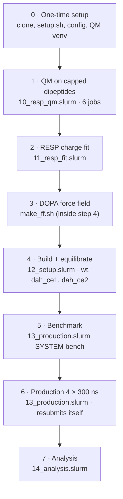

# Phl p 5a Y65 → L-DOPA: free MD of wild type vs. mutant

Unrestrained molecular dynamics (MD) to see how hydroxylation of Tyr65 to
L-DOPA (3,4-dihydroxyphenylalanine, PDB residue code `DAH`) changes the
structure and dynamics of the major grass pollen allergen Phl p 5a.

Unlike the SSI runs in the main workflow (protein heavy atoms restrained, so
the structure cannot change), everything here is free MD, including the
wild-type reference.

**Contents:** [Background](#background) ·
[Workflow: what happens and why](#workflow-what-happens-and-why) ·
[Design decisions](#design-decisions) · [DOPA parameters](#dopa-parameters) ·
[Running on Viper](#running-on-viper) ·
[Outputs and interpretation](#outputs-and-interpretation) ·
[Limitations](#limitations) · [Files](#files) · [References](#references)

---

## Background

**Chemistry.** Peroxynitrite (ONOO⁻), formed under oxidative stress and
enhanced by air pollution, decomposes into ·NO₂, CO₃·⁻ and a small amount of
·OH. These radicals modify tyrosines in three ways: nitration
(3-nitrotyrosine), cross-linking (dityrosine) and hydroxylation. Hydroxylation
starts with ·OH adding to the aromatic ring; addition next to the phenolic OH
(at CE1 or CE2) and subsequent oxidation gives L-DOPA, a catechol with two
adjacent OH groups. In LC-MS/MS hydroxylation shows up as +16 Da, which
neither distinguishes DOPA from other hydroxylation products nor tells on
which ring edge the new OH sits.

**Phl p 5a.** In Bothen et al. (*Free Radic. Res.* 2026,
doi:10.1080/10715762.2026.2752377) all 12 tyrosines of Phl p 5a were
modified site-selectively. **Y65** stood out: highest nitration degree at
every peroxynitrite dose (~95 % at 5:1), mostly single nitration, and
3.1 % hydroxylation. It sits in an α-helix (residues 64–84) of the first
helical domain and is partly buried (relative solvent accessibility 0.23).
In the AlphaFold 3 model its ring packs into a cluster with three other
tyrosines (Y112, Y124, Y127; ring atoms 3.5–4.1 Å apart).

**Question.** Does the extra OH group of DOPA65 change the local structure:
packing in the tyrosine cluster, hydrogen bonds, side-chain conformation,
flexibility and helicity around the site? This matters because modified
residues can alter how an allergen is recognized by the immune system.

**What free MD can and cannot answer.** In a few hundred nanoseconds MD
samples local rearrangements: side-chain repacking, hydrogen-bond networks,
fraying of helix ends. It does not sample unfolding or give a
thermodynamic stability change (ΔΔG); that would need alchemical
free-energy calculations (e.g. Gapsys et al. 2016). Because MD is chaotic,
a single run is one sample; differences only count if they exceed the
spread between independent replicas (Knapp et al. 2018; Grossfield et al. 2018).

---

## Workflow: what happens and why



| Step | What happens | Why it is needed | Script | In → out | Cost (Viper) |
|------|--------------|------------------|--------|----------|--------------|
| **0** One-time setup | clone branch, `setup.sh` (paths), `config/workflow.env` (GROMACS, modules), Python venv with PySCF | scripts need absolute paths and the self-compiled GROMACS; DOPA charges need a QM program (ORCA is license-restricted at MPCDF) | `setup.sh`, `params/make_qm_venv.sh` | – → configured checkout, venv | minutes, login node |
| **1** QM | builds Ace-X-NMe dipeptides (DOPA: 2 backbone × 2 OH patterns; Tyr: 2 backbone), optimizes them at HF/6-31G* with φ/ψ frozen, computes the electrostatic potential (ESP) on ~9 000 points around each molecule | the force field has no DOPA; atomic partial charges must be derived exactly like the existing amber charges, from the ESP of a QM calculation | `slurm/10_resp_qm.slurm` (array 0–5) | – → `runs/dopa/qm/<conf>/` (`.xyz`, `_vpot.out`) | 6 × 16 cores, ~0.5–2 h |
| **2** RESP fit | fits one set of charges that reproduces the ESP of all conformers, with restraints; Tyr is fitted the same way as a check | charges must not depend on one conformation; the Tyr refit shows whether the protocol reproduces ff99SB | `slurm/11_resp_fit.slurm` | QM files → `params/results/`, `ff/dah.rtp`, `ff/dah.hdb` | 1 core, minutes |
| **3** Force field | copies amber99sb-ildn, appends residue `DAH`, registers `DAH` as protein | GROMACS can only build topologies for residues it knows; "Protein" index groups must include DAH | `ff/make_ff.sh` (called in step 4) | `dah.rtp/.hdb` → `<system>/amber99sb-ildn-dopa.ff/`, `residuetypes.dat` | seconds |
| **4a** Build | cuts domain 34–144 from the AF3 model, adds ACE/NME caps, places the DOPA O (variants), adds hydrogens (`pdb2gmx`) | a smaller, well-folded system is ~20× cheaper; caps avoid artificial charged ends; both ring orientations are needed (see below) | `src/make_system_pdb.py`, `12_setup.slurm` | AF3 model → `start.pdb`, `topol.top` | seconds |
| **4b** Solvate + ions | rhombic dodecahedron (1.2 nm to the wall), TIP3P water, neutralize, 0.15 M NaCl | protein behaviour depends on water and ionic strength; Y65 has charged neighbours | `12_setup.slurm` | → `solv_ions.gro` (~35–40k atoms) | seconds |
| **4c** Energy minimization | steepest descent | removes atom overlaps from building (e.g. the new O in `dah_ce2`) that would otherwise blow up the simulation | `12_setup.slurm` | → `em.gro` | minutes |
| **4d** NVT 100 ps, restrained | heat to 300 K with random velocities, one seed per replica, protein heavy atoms restrained | water must relax around the fixed protein first; different seeds make the 4 replicas independent | `12_setup.slurm` | → `rep*/nvt.gro` | minutes |
| **4e** NPT 1 ns, restrained | pressure coupling to 1 bar, still restrained | box volume and water density must settle before the protein is released | `12_setup.slurm` | → `rep*/npt.gro`, `rep*/md.tpr` | ~10–30 min |
| **5** Benchmark | 20 000 steps of production | real ns/day on Viper → how many 12 h jobs production needs | `13_production.slurm SYSTEM bench` | → `rep*/bench.log` | ~10 min |
| **6** Production | 300 ns unrestrained NPT per replica, 4 replicas in one node job; continues from checkpoints and resubmits itself every 12 h | only unrestrained dynamics shows structural change; 4 independent replicas give error bars | `13_production.slurm` | → `rep*/md.xtc` (protein every 10 ps) | 1 node per system; days (see benchmark) |
| **7** Analysis | whole/centered protein trajectories, side-chain SASA, then the comparison WT vs. DOPA | turns trajectories into numbers with mean ± SEM over replicas | `14_analysis.slurm`, `src/analyze_dopa.py` | → `runs/dopa/analysis/` | 1 node-share, < 1 h |

---

## Design decisions

| Choice | Value | Why |
|--------|-------|-----|
| Structure | AF3 model (`examples/PHLP5/PHLP5_input.pdb`), same as in the paper | there is no complete experimental structure of Phl p 5a |
| System | helical domain 1, residues 34–144, ACE/NME caps | N-terminus (1–35), linker (141–160) and C-tail (258–287) have pLDDT < 50 (likely disordered); full length is ~17 nm long, ~800k atoms in a cube vs. ~35–40k for the domain; every residue within 6 Å of the Y65 side chain lies in 61–127, and the domain touches the rest of the model at a single residue (222); NMR data indicate largely independent domains (Göbl et al. 2017) |
| Variants | `wt`, `dah_ce1`, `dah_ce2` | DOPA is not symmetric: the new 3-OH sits on either ring edge; packed rings flip on µs–s time scales (Weininger et al. 2014), so the starting orientation would persist through 300 ns; both are simulated |
| Force field | amber99sb-ildn + TIP3P | validated for folded proteins (Lindorff-Larsen et al. 2010, 2012); shipped with GROMACS; ff99SB-ILDN differs from ff99SB only in side-chain torsions of Ile, Leu, Asp, Asn, so the DOPA charges apply unchanged |
| Ions | neutralize + 0.15 M NaCl | physiological ionic strength; Y65 neighbours D63, K64, R66, E116, K123 |
| Box | rhombic dodecahedron, 1.2 nm | ~71 % of the volume of a cube with the same periodic distance |
| Thermostat / barostat | V-rescale 300 K (Bussi et al. 2007), C-rescale 1 bar (Bernetti & Bussi 2020) | correct ensembles, robust |
| Production | 4 replicas × 300 ns per system | 300 ns covers local rearrangements; 4 × 32 cores fill one Viper node (`mdrun -multidir`), same cost as 3 replicas |
| Walltime | 12 h jobs, `-maxh 11.5`, automatic resubmission | cluster limit |

**Ring orientation in the model.** In `dah_ce2` the new O starts 2.5 Å from
the ring of Y127 (in `dah_ce1` the nearest atom is 4.7 Å away): that ortho
carbon is sterically blocked in the model, so hydroxylation there is less
likely. Energy minimization removes the clash. Compare with the atom-level
ASA of CE1/CE2 of Y65 in Table 1 of the paper; if one side is clearly
inaccessible, that variant can be treated as a control.

---

## DOPA parameters

**Bonded terms** come from parm99 (Wang et al. 2000). Both hydroxylated ring
carbons are typed `CA` (Tyr uses `C` for CZ, but the angle `C–CA–OH` is not
defined), so `CA–OH`, `CA–CA–OH`, `CA–OH–HO`, `X–CA–OH–X` and the improper
`CA–CA–CA–OH` cover the catechol. Nothing new is invented.

**Partial charges** are derived with the recipe used for the amber protein
charges (Bayly et al. 1993; Cornell et al. 1995; Cieplak et al. 1995). Charges
from other libraries (e.g. Forcefield_PTM, Khoury et al. 2013) follow the
ff03 recipe and would be inconsistent with ff99SB.

- Ace-DAH-NMe, backbone α (φ, ψ = −60°, −40°) and β (−120°, 140°), φ/ψ
  frozen, everything else relaxed; both intramolecular catechol H-bond
  patterns (3-OH or 4-OH donating) → 4 conformers
- HF/6-31G* gas phase (deliberately overpolarized, mimicking water, as in
  ff94), Cartesian d functions as in Gaussian's 6-31G*; PySCF (Sun et al. 2020)
  with geomeTRIC (Wang & Song 2016)
- Merz–Kollman shells 1.4/1.6/1.8/2.0 × vdW radius, 6 points/Ų
- two-stage RESP (a = 0.0005 / 0.001, b = 0.1); backbone N, H, C, O fixed to
  the ff99SB values; residue and caps neutral
- check: Tyr fitted with the same protocol vs. the ff99SB Tyr charges, see
  `params/results/resp_report.txt`

DOPA is modelled in its reduced, neutral catechol form (pKa ≈ 9–10,
Lee et al. 2011).

---

## Running on Viper

### One-time setup

```bash
cd /ptmp/$USER
git clone -b dopa-y65 https://github.com/klimacht/ssi-workflow.git ssi-dopa
cd ssi-dopa
./setup.sh /ptmp/$USER/ssi-dopa        # without SOFTWARE_ROOT: no PLUMED download
# config/workflow.env: GROMACS build and the modules it was compiled with
sed -i -e "s|/path/to/software|$HOME/software|g" \
       -e "s|^MODULE_GCC=.*|MODULE_GCC=gcc/15|" \
       -e "s|^MODULE_IMPI=.*|MODULE_IMPI=impi/2021.17|" config/workflow.env
bash dopa/params/make_qm_venv.sh /ptmp/$USER/venvs/qm     # PySCF + geomeTRIC
```

Settings for this study (domain, systems, replicas, paths) are in
`dopa/dopa.env`.

### Stages

```bash
bash dopa/bin/dopa_submit.sh resp            # steps 1-2 (once; results get committed)
bash dopa/bin/dopa_submit.sh setup           # step 4 for wt, dah_ce1, dah_ce2
bash dopa/bin/dopa_submit.sh bench wt        # step 5
bash dopa/bin/dopa_submit.sh prod            # step 6 (waits for running setup jobs)
bash dopa/bin/dopa_submit.sh analysis        # step 7, after production
bash dopa/bin/dopa_submit.sh all             # steps 4 + 6 chained for all systems
```

Append `--dry-run` to see the `sbatch` calls without submitting.

### Monitoring

```bash
squeue -u $USER                                    # queue
tail -f logs/dopa_md.<jobid>.out                   # production log
grep Performance runs/dopa/wt/rep*/md.log          # ns/day
cat runs/dopa/wt/resubmit.count                    # number of 12 h restarts so far
```

To update the checkout after changes on GitHub (`setup.sh` edits tracked
files, `config/workflow.env` and `runs/` are untracked and stay):

```bash
git checkout -- . && git pull && ./setup.sh /ptmp/$USER/ssi-dopa
```

---

## Outputs and interpretation

Per replica the first 50 ns are discarded (`DOPA_SKIP_NS`); values are then
averaged per replica, and systems are compared by mean ± SEM over the 4
replicas. Results go to `runs/dopa/analysis/`:

| File | Content |
|------|---------|
| `summary.tsv` | per metric and system: mean ± SEM, Welch p vs. WT, per-replica values |
| `per_residue.tsv` | Cα RMSF and DSSP helicity per residue |
| `contacts.tsv` | side-chain contact occupancy of residue 65 (≥ 5 % in any system) |
| `hbonds.tsv` | H-bonds of the OH groups of residue 65 (donor and acceptor) |
| `rmsf_helicity.png`, `rmsd_time.png`, `chi1_chi2.png` | overview plots |

| Metric | What it tells | A DOPA effect would look like |
|--------|---------------|-------------------------------|
| core Cα RMSD | overall drift of the helical core from the starting model | larger, or a different plateau than WT |
| Cα RMSF per residue | local flexibility | peaks near residue 65 or in packing partners (helices around 108–127) |
| helicity (DSSP) | secondary structure per residue; `helicity_64:84` for the Y65 helix | unwinding near the site or at helix ends |
| χ1 populations, χ2 map | side-chain conformation of residue 65 | shifted rotamers |
| ring-flipped fraction | how often the ring turns by > 90° from its start | DOPA ring flips more/less, or settles in the other orientation |
| ring distances 65–112/124/127 | packing in the tyrosine cluster | cluster opens (larger distance) or tightens |
| contacts, H-bonds | neighbours and H-bond partners of the OH groups | new partners for the 3-OH, lost or new contacts |
| side-chain SASA | burial of residue 65 | DOPA more exposed or more buried than Tyr |

Read differences together with the replica spread: a mean shift that is
smaller than the SEM, or carried by one replica, is not a result. With
n = 4 the p-values are only a rough guide. Effects that appear in both
`dah_ce1` and `dah_ce2` are more robust than effects in one orientation.

---

## Limitations

- one domain only: possible transient contacts with the N-terminus or domain 2 are missing
- AF3 starting model: inter-domain arrangement and disordered regions are uncertain
- 300 ns covers local rearrangements, not unfolding; no ΔΔG (see Background)
- DOPA is modelled reduced and neutral; oxidation to dopaquinone and cross-linking are not included
- fixed-charge force field: no polarization beyond what the HF/6-31G* charges imply
- n = 4 replicas per system

---

## Files

```
dopa/
├── README.md
├── dopa.env                  study settings (sourced after config/workflow.env)
├── bin/dopa_submit.sh        submits the stages
├── params/
│   ├── resp_dopa.py          dipeptide builder, QM (PySCF), RESP fit, rtp/hdb writer
│   ├── make_qm_venv.sh       Python venv with PySCF + geomeTRIC
│   └── results/              RESP report and charges (after step 2)
├── ff/
│   ├── make_ff.sh            DOPA-enabled copy of a GROMACS force field
│   └── dah.rtp, dah.hdb      residue template (after step 2)
├── src/
│   ├── make_system_pdb.py    domain + caps + DOPA variants
│   └── analyze_dopa.py       replica-based comparison
├── mdp/                      em, nvt, npt, md
└── slurm/                    10_resp_qm … 14_analysis
```

---

## References

Chemistry and system
- Bothen, N.; Klimach, T.; Munk, V. K.; Backes, A. T.; Berkemeier, T.; Weller, M. G. et al., *Free Radic. Res.* 2026, doi:10.1080/10715762.2026.2752377
- Göbl, C. et al., *J. Allergy Clin. Immunol.* 2017 (Phl p 5 domain structure by NMR)
- Abramson, J. et al., *Nature* 2024, 630, 493 (AlphaFold 3)
- Lee, B. P.; Messersmith, P. B.; Israelachvili, J. N.; Waite, J. H., *Annu. Rev. Mater. Res.* 2011, 41, 99 (DOPA chemistry)

Charges and force field
- Bayly, Cieplak, Cornell, Kollman, *J. Phys. Chem.* 1993, 97, 10269 (RESP)
- Cornell et al., *J. Am. Chem. Soc.* 1995, 117, 5179 (ff94)
- Cieplak, Cornell, Bayly, Kollman, *J. Comput. Chem.* 1995, 16, 1357 (multi-conformation RESP)
- Wang, Cieplak, Kollman, *J. Comput. Chem.* 2000, 21, 1049 (parm99)
- Khoury et al., *J. Chem. Theory Comput.* 2013, 9, 5653 (Forcefield_PTM)
- Hornak et al., *Proteins* 2006, 65, 712 (ff99SB)
- Lindorff-Larsen et al., *Proteins* 2010, 78, 1950 (ILDN); *PLoS ONE* 2012, 7, e32131
- Sun et al., *J. Chem. Phys.* 2020, 153, 024109 (PySCF)
- Wang, Song, *J. Chem. Phys.* 2016, 144, 214108 (geomeTRIC)

Simulation and analysis
- Bussi, Donadio, Parrinello, *J. Chem. Phys.* 2007, 126, 014101; Bernetti, Bussi, *J. Chem. Phys.* 2020, 153, 114107
- Knapp, Ospina, Deane, *J. Chem. Theory Comput.* 2018, 14, 6127 (replicas)
- Grossfield et al., *Living J. Comput. Mol. Sci.* 2018, 1, 5067 (uncertainty)
- Weininger et al., *Biochemistry* 2014, 53, 4519 (ring flips)
- Kabsch, Sander, *Biopolymers* 1983, 22, 2577 (DSSP)
- Gapsys et al., *Angew. Chem. Int. Ed.* 2016, 55, 7364 (ΔΔG by free-energy calculations)
- Hollingsworth, Dror, *Neuron* 2018, 99, 1129 (introduction to MD)
